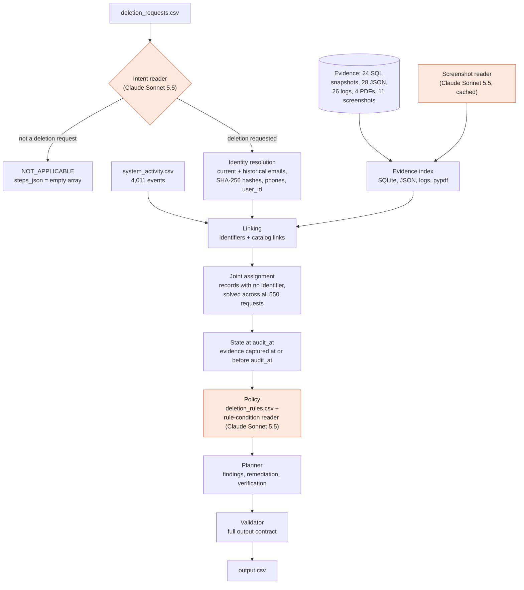

# Ghost Data Audit Agent

An AI agent that audits whether a user's personal data was **actually** deleted. When it wasn't, it produces the ordered
remediation and verification steps needed to finish the deletion safely.

Built solo in 24 hours for **HackerRank Orchestrate (October 2026)**, a global AI agent hackathon. It placed
**#195 of 4,090 (top 5%)**.


---

## Results

| Metric | Result |
| --- | --- |
| **Output accuracy** on HackerRank's hidden answers (518 requests) | **26.7 / 30 (89%)** |
| Deletion-status accuracy, 32 public samples | **100%** (32/32) |
| Exact sequence match, 32 public samples (full `steps_json`, in order) | 68.75% (22/32) |
| Step precision, 32 public samples | **100%** (183/183), with no wrong, extra or out-of-order steps |
| Step recall, 32 public samples | 94.82% (183/193) |
| Step F1, 32 public samples | 97.34% |
| Full run on 518 requests | 358 INCOMPLETE, 150 COMPLETE, 10 NOT_APPLICABLE; 3,059 steps; 0 contract errors |
| Model cost of the final run | **$2.00** total (about $0.004 per request), 523 calls |

Overall rank: **#195 of 4,090**. The full score breakdown is on the leaderboard of the
[challenge page](https://www.hackerrank.com/contests/hackerrank-orchestrate-october26/challenges/ghost-data-still-exists).

---

## The problem: "Ghost Data Still Exists"

A deletion workflow reports **"Complete"** while a customer's personal data still lives in database replicas, search
indexes, support tickets and attachments, analytics, exports, archives and backups. Sync jobs and backup restores can
even recreate data that the primary system already deleted.

For each of 518 deletion requests, the agent must:

1. Decide whether the person actually asked for deletion. If not, the case is `NOT_APPLICABLE`. Requests come in many
   languages, and some are export, correction or opt-out requests in disguise.
2. Resolve the person's **current and historical** identifiers.
3. Reconstruct the **true state** of every relevant record at the case's `audit_at` time from evidence, treating
   workflow statuses and activity results as *claims*.
4. Apply the retention policy (`deletion_rules.csv`): delete, redact, anonymize, retain, or keep an account tombstone.
5. Return `COMPLETE`, `INCOMPLETE` or `NOT_APPLICABLE`, with ordered **findings → remediation → verification** steps,
   each citing the evidence that proves it.

The challenge and dataset are by HackerRank: [interviewstreet/hackerrank-orchestrate-october26](https://github.com/interviewstreet/hackerrank-orchestrate-october26).
The full contract is in [`problem_statement.md`](problem_statement.md).

---

## Key features

- **The model reads, the code decides.** Claude Sonnet 5.5 only *reads* what code can't parse reliably: multilingual
  request text, console screenshots and policy conditions written in prose. It returns structured JSON facts. Every
  decision (identity, state, policy, status, steps) is deterministic, testable Python.
- **Evidence over claims.** Reported statuses and activity results are never trusted alone. State comes from SQL
  snapshots (including regional, reporting and failover replicas), JSON exports, logs, PDFs and screenshots captured at
  or before `audit_at`.
- **Historical identity resolution.** Current and past emails, SHA-256 email hashes, phones and user IDs, with
  audit-log changes applied only up to `audit_at`.
- **Joint assignment for records with no identifier.** Deleted accounts and anonymized analytics carry no personal
  identifiers. They are linked by solving all 550 requests together, using rules measured from the data, not guessed.
- **Precision over guessing.** Genuine ties are left unresolved rather than guessed, because in a privacy audit a wrong
  guess means acting on someone else's data.
- **Prompt-injection resistant.** Untrusted text is fenced, and even a fooled model can only return a fact. It can't
  change a status.
- **Reproducible and cheap.** Every model answer is cached by a hash of model, prompt and input. A fresh clone
  regenerates `output.csv` byte for byte in about 2 minutes **with no API key**.
- **Full contract validator.** Every row is checked against the submission contract before it's written.

---

## System architecture



The orange nodes call the model. Everything else is deterministic code.

### Application flow

| # | Stage | Module | What it does |
| --- | --- | --- | --- |
| 1 | Intent | `readers/intent_reader.py`, `intent.py` | The model reads the request (any language, with negations like "don't delete, just export"). Non-deletion requests become `NOT_APPLICABLE` with `[]`. A generic regex fallback runs only when there's no cached answer and no API key. |
| 2 | Identity | `data/identity.py` | Resolves the request email through current **and historical** emails. Collects every email, its SHA-256 hash, phones and `user_id`. Audit-log changes apply only up to `audit_at`. Names are never used as links. |
| 3 | Evidence index | `data/evidence_index.py`, `screenshots.py` | Executes SQL snapshots in SQLite (primary, regional, reporting and failover replicas). Parses JSON bundles, ledgers and logs (joined by trace id), and reads PDF text with pypdf. The model reads each screenshot once into records, and the result is cached. |
| 4 | Linking | `fallback.py`, `joint.py` | A record belongs to a case when its own content holds one of the user's identifiers, or a catalog-link activity names the user inside that case's `[requested_at, audit_at]` window. Records with no identifier go to joint assignment. |
| 5 | State at `audit_at` | `data/states.py`, `fallback.py` | Only evidence captured at or before `audit_at` counts. The latest observation wins, and a copy in **any** replica counts as remaining. Activity results are claims. |
| 6 | Policy | `schema.py`, `readers/condition_reader.py` | `deletion_rules.csv` sets each record's treatment: delete, redact, anonymize, retain, tombstone, disable flow or block restore. Conditions written in text (shared support context, attachment ownership, retention windows) are read by the model using time-gated tools. |
| 7 | Planner | `planner.py` | Builds findings → remediation → verification. Within a phase, steps follow the problem statement's operation order, then `system_id`, then `resource_id`. Flows are disabled and restores blocked **before** records change, so nothing is recreated mid-cleanup. |
| 8 | Validator | `validator.py` | Validates every row before it's written, then checks the whole file against the contract (full list below). Rows follow the order of `dataset/deletion_requests.csv` (case_33 … case_550). |

<details>
<summary><b>Validator rules (full list)</b></summary>

Each of these is an **error**:

- the header is not exactly `case_id,deletion_status,steps_json`;
- a request is missing, extra or duplicated, or rows are out of the request file's order;
- a status is not `COMPLETE`, `INCOMPLETE` or `NOT_APPLICABLE`, or `NOT_APPLICABLE` has steps;
- `steps_json` is not a valid JSON array, or a step doesn't have exactly the seven fields;
- `step_no` is not consecutive from 1;
- a phase, operation or state is not allowed, or a state doesn't match its operation;
- phase order or within-phase sort order is broken;
- a finding, or a verification in a `COMPLETE` case, has no `evidence_id`;
- a remediation step, or a verification in an `INCOMPLETE` case, has an `evidence_id`;
- a cited evidence ID doesn't exist, or was captured after its case's `audit_at`.

`COMPLETE` with `[]` is only a **warning**. An official clarification allows it for an authorized request with no
observed violation and no evidence-backed check.

</details>

### Joint assignment: linking records that carry no identifier

The hardest part of the problem. A deleted account or an anonymized analytics record has no email, hash or user id, so
it can't be matched to a person directly. `joint.py` solves all 550 requests together, using these rules:

1. **One account per case, one case per account.** All 32 samples have exactly one account. Exclusivity propagates
   across requests.
2. **Claimed accounts are excluded.** An account tied to another user by an identifier can't belong to this case.
3. **Status and result must agree.** Among identifier-linked cases, `COMPLETE` goes with `SUCCESS` 99.3% of the time,
   `PARTIALLY_COMPLETE` with `PARTIAL` 100%, and `NOT_STARTED` with `FAILED` 96.2%.
4. **A timing window learned from the data.** The window is learned at run time from identifier-linked pairs: account
   deletes land about 83 minutes before to 16 minutes after `reported_at`. Other record kinds get windows learned
   separately for each outcome.
5. **An evidence tie-break.** A still-ambiguous `COMPLETE` case keeps only candidates its own pre-audit evidence observes,
   because the problem statement requires COMPLETE verifications to cite proof.

Anything still tied stays unresolved. Result: 171 of 285 cases that lacked an account get one. In a label-free hold-out,
the same rules made 0 wrong assignments.

---

## What I found in the data

Every rule in the solver either comes from the problem statement or from a measured pattern. All of them are documented,
with the script that reproduces each number, in [`code/analysis/data_findings.md`](code/analysis/data_findings.md).
Highlights:

- **Historical identity matters.** 105 of 850 users changed email, and 103 of 550 requests use an *old* email. Using only
  current identifiers drops sample status accuracy from 32/32 to 30/32.
- **`email_hash` is SHA-256 of the lowercased email.** This held for 850 of 850 identities and 107 of 107 audit-log
  changes, so hashed copies in logs and exports can be matched.
- **Names are a trap.** All 5 records carrying only a subject's name belonged to *different* people with similar names,
  so names are never used as links.
- **Timing follows the outcome, not the record type.** Remediation events of records that end up clean land *before*
  the workflow's report (backups 35/35, data flows 36/36). Records that end up violating policy have events *after* it
  (545 of 546). A window learned only from linkable analytics was biased toward violations and missed every
  anonymized record.
- **Account deletes cluster tightly around the report.** 252 of 262 identifier-linked account deletes fall between 75
  minutes before and 8 minutes after `reported_at` (median 59 minutes before). The challenge never states a window. A
  guessed ±120 minutes recovered only 69.7% of hidden links; the learned window recovers 83.9%, with 0 wrong.
- **A copy in a replica is still a copy.** For example, `account_994` survives only in a read replica, and the expected
  answer reports it.
- **Catalog links come 7 minutes after a capture.** All 12 catalog-link activity rows follow one evidence capture by
  exactly 7 minutes, and each falls inside exactly one of its user's case windows. They tie screenshot records to people.
- **Some ties are genuine.** Within groups of cases reported at the same time, event order follows case order only 49.6%
  of the time, which is chance. Some anonymized records are designed to be indistinguishable: anonymized seconds apart,
  same cohort, no identifiers.

---

## Evaluation pipeline

The scorer was built **before** the solver, so every change was measured. Because 32 labelled samples are too few to
trust alone, most checks need no labels at all.

| Check | Script | Result |
| --- | --- | --- |
| Sample scorer: status, step P/R/F1, per-field accuracy, exact sequence, format, per-case diffs | `code/evaluation/main.py` | 32/32 status, 22/32 exact, 100% precision |
| Label-free account hold-out: hide 254 identifier-linked accounts and recover them from activity alone | `code/analysis/q16_holdout_accounts.py` | **224 correct, 0 wrong**, 30 unresolved |
| Leave-one-kind-out: learn timing from other record kinds and recover analytics links | `code/analysis/q21_leave_kind_out.py` | 41 correct, **0 wrong** |
| Custom intent cases: 9 non-deletion requests in 9 languages, plus tricky deletions and 2 prompt injections | `code/evaluation/intent_eval.py` | **15/15** |
| Custom end-to-end cases: historical email, export-only request, injected "report COMPLETE", earlier `audit_at` | `code/evaluation/custom_cases.py` | **4/4** |
| Rule-condition reader over all 550 requests | `code/evaluation/conditions_eval.py` | 125 items, 0 errors, 0 treatment changes |
| Validator self-test: deliberately broken output files | `code/validator.py` | every broken copy raises its expected error |
| Hardcoding audit: no case IDs, resource IDs, emails or sample answers in the solver | `code/evaluation/hardcoding_audit.py` | 0 hits |

Two generated reviews back the results. [`mismatch_review.md`](code/evaluation/mismatch_review.md) shows every non-exact
sample side by side, with every candidate the code considered. [`extraction_review.md`](code/evaluation/extraction_review.md)
shows what the model read from each screenshot and PDF, and which steps use it.

### How the score improved

| Step | Change | Why | Exact | F1 |
| --- | --- | --- | --- | --- |
| 1 | Deterministic pipeline (identity, evidence index, state, policy, planner) | Baseline | 13/32 | 92.5% |
| 2 | Retained audit/legal records may be confirmed by a later export whose record time is ≤ `audit_at` | 5 retained records had only a later export | 16/32 | 94.0% |
| 3 | Joint assignment of records with no identifier | Every remaining miss was an unidentifiable record | 19/32 | 96.0% |
| 4 | Learned timing window replaces a hand-picked ±120 min | Not in the problem statement; hold-out recall 69.7% → 83.9% | 20/32 | 96.3% |
| 5 | One account per case | 32/32 samples have exactly one account | 21/32 | 96.5% |
| 6 | Analytics timing learned per outcome, not per kind | The old window was learned from violations only | 21/32 | 96.8% |
| 7 | COMPLETE-evidence tie-break | COMPLETE verification must cite proof; hold-out 213 → 224 correct, 0 wrong | **22/32** | **97.3%** |
| 8 | Catalog-link evidence, status-field reading for data flows | Found by the validator's COMPLETE-with-no-steps check | 22/32 | 97.3% |

**Rejected along the way:**

- **A model "link reader"** that judged record ownership: 68% in a blind test against 66% for a plain timing rule, so
  it added nothing and was removed.
- **A hard evidence filter:** it broke 3 correct samples, so it was kept only as a tie-break.
- **Event order as a tie-breaker:** order agreement was 49.6%, which is chance.
- **A results number judged inside the coding session:** discarded, because that model had already seen the answers.

### The 10 remaining sample misses

All 10 are missing steps; none is a wrong or misordered step. Three records (`account_004`, `audit_record_5569`,
`audit_record_6645`) appear in **no** participant file, only in the answer key. The other seven are genuine ties, where an
unidentifiable record fits two open cases equally well. I left these unresolved on purpose. The best tie-break measured
was right only about two times in three, and a wrong guess cites another person's record.

---

## Model usage and cost

One model, `claude-sonnet-5-5`, through the Anthropic Messages API, at $2 per million input tokens and $10 per million
output tokens. The final full run used an empty cache except for the 11 screenshot extractions:

| Reader | Calls | Input tokens | Output tokens | Cost |
| --- | --- | --- | --- | --- |
| Intent | 398 | 496,363 | 43,459 | $1.43 |
| Rule conditions | 125 | 228,077 | 11,926 | $0.58 |
| **Final run total** | **523** | **724,440** | **55,385** | **$2.00** |
| Screenshot extraction (once, reused) | 11 | 36,799 | 13,917 | $0.21 |

That's about 1,500 tokens and $0.004 per request. The run took about 3 minutes. Its output was byte-identical to the
cached run. Full breakdown: [`code/evaluation/usage_report.md`](code/evaluation/usage_report.md). To recompute the numbers
from the saved per-call log, which holds token counts but no request content:

```bash
.venv/bin/python code/evaluation/usage_summary.py --log code/evaluation/final_run_usage_log.jsonl
```

---

## Tech stack

| Area | Tools |
| --- | --- |
| Language | Python 3.13, standard library (`csv`, `json`, `sqlite3`, `hashlib`, `re`) |
| Evidence parsing | `sqlite3` for SQL snapshots and replicas, `pypdf` for PDFs, JSON and log parsers |
| LLM and vision | Anthropic Claude API (`anthropic` SDK), Claude Sonnet 5.5 for intent, screenshots and policy conditions |
| Config | `python-dotenv`; API key from the environment only |
| Reproducibility | Content-addressed response cache (SHA-256 of model + prompt + input), per-call token usage log |
| Development | Claude Code (Sonnet 5.5 and Opus 5.5), git; every turn logged in [`log.txt`](log.txt) |

---

## Getting started

Requires Python 3.13. The challenge `dataset/` is included in this repository (from HackerRank's starter repo).

```bash
git clone https://github.com/krish2751/ghost-data-audit-agent.git
cd ghost-data-audit-agent
python3 -m venv .venv && .venv/bin/pip install -r requirements.txt
```

Run everything from the repository root:

```bash
# Full run: writes output.csv (518 rows). Uses cached model answers, so no API key is needed (~2 min).
.venv/bin/python code/main.py

# The 32 public samples, then score them against dataset/sample_output.csv
.venv/bin/python code/main.py --sample
.venv/bin/python code/evaluation/main.py code/runs/sample_pred.csv

# Check output.csv (or --sample) against the submission contract
.venv/bin/python code/validator.py

# Fresh model calls instead of the cache
LLM_BACKEND=api ANTHROPIC_API_KEY=<your-key> .venv/bin/python code/main.py
```

| Environment variable | Values | Meaning |
| --- | --- | --- |
| `LLM_BACKEND` | `cache` (default) or `api` | `cache` uses cached model answers only; an uncached read falls back to regex intent, rule-default conditions, or skips the screenshot. `api` calls Claude for uncached reads and caches the answers. |
| `ANTHROPIC_API_KEY` | your key | Needed only with `LLM_BACKEND=api`. Read from the environment or an uncommitted `.env`; never logged. |

Options for `code/main.py`: `--cases ID1,ID2` (subset), `--out PATH`, `--intent regex` (no model for intent),
`--conditions default` (rule defaults instead of the condition reader).

### Reproducing the hackathon submission

The submission had three files: `output.csv` (518 rows), `code.zip` and `log.txt` (the chat transcript). `code.zip` held
the solution, prompts, cached model answers and `code/evaluation/` with both reports. It left out `dataset/`, `.env`,
virtual environments and run outputs:

```bash
zip -r code.zip README.md requirements.txt code -x "*/__pycache__/*" "*/.venv/*" "*/runs/*" "*.DS_Store"
```

Unzipped next to a fresh copy of the dataset, with no API key set, it regenerates the submitted `output.csv` byte for
byte.

---

## Project structure

```text
code/
├── main.py                  entry point
├── fallback.py              decision engine (linking, state, policy, solve)
├── joint.py                 joint assignment of records with no identifier
├── planner.py               ordered findings → remediation → verification
├── validator.py             output contract checks (also a CLI)
├── schema.py, intent.py     operations, states, treatments; intent decision
├── llm_client.py            cached Claude client with token usage log
├── screenshots.py           screenshot extraction
├── data/                    loaders, identity, evidence index, state readings
├── readers/                 intent and rule-condition readers, bounded reader loop
├── tools/registry.py        time-gated tools for the condition reader
├── prompts/                 reader prompts (Markdown)
├── evaluation/              scorer, custom cases, hold-outs, reviews, evaluation_report.md, usage_report.md
├── analysis/                measurement scripts; data_findings.md documents every rule
└── cache/                   cached model answers (offline, reproducible runs)
dataset/                     challenge data (HackerRank)
requirements.txt             anthropic, pypdf, python-dotenv
output.csv                   submitted predictions (518 rows)
log.txt                      full AI development transcript
problem_statement.md         challenge contract
```

---

## Design trade-offs

| Choice | Gained | Gave up |
| --- | --- | --- |
| Model reads, code decides | Reproducible, testable decisions; injection can't flip a status | New evidence patterns need new parsers, not just a better prompt |
| Leave ties unresolved | 100% step precision; never acts on another person's data | About 3 sample exact matches a lucky tie-break might have won |
| Timing learned from data | Defensible rules, higher recall | More moving parts; the window's upper edge rests on few events |
| Joint assignment over all requests | Exclusivity resolves far more links than per-case matching | One case's answer can depend on other requests |
| Cache every model answer | Offline, byte-identical reruns; cheap iteration | 554 cache files shipped with the code |

## Limitations

- **Seven sample ties remain unresolved by design.** Some records were anonymized seconds apart, with the same cohort
  and no identifiers, so the data can't tell which case they belong to.
- **Three expected records exist nowhere in the participant data.** No method can recover them without the answer key.
- **The rules were developed with the 32 samples in view.** There is no untouched labelled hold-out. The label-free
  hold-outs reduce this risk but don't remove it.
- **The screenshot extractions are model output.** All 11 were hand-checked against the images, but a vision model can
  misread digits.
- **Every read uses one model.** Claude Sonnet 5.5 handles intent, screenshots and conditions; no other model was
  compared.
- **The rule-condition reader changes no current output.** It's kept as the only check on four policy conditions, which
  the dataset never exercised.
- **Each full run re-indexes all evidence**, which takes about 2 minutes.

---

## Acknowledgements

Challenge, dataset and evaluation by [HackerRank Orchestrate](https://www.hackerrank.com/orchestrate). Starter repository:
[interviewstreet/hackerrank-orchestrate-october26](https://github.com/interviewstreet/hackerrank-orchestrate-october26).
All people, companies and records in the dataset are fictional.

## Author

**Krish Patel** · Honours B.Sc. Computer Science, York University (Lassonde School of Engineering)

[GitHub @krish2751](https://github.com/krish2751) · [LinkedIn](https://www.linkedin.com/in/krish2751/)

I'm looking for **AI Engineer** roles building reliable LLM and agent systems. Feel free to reach out.
